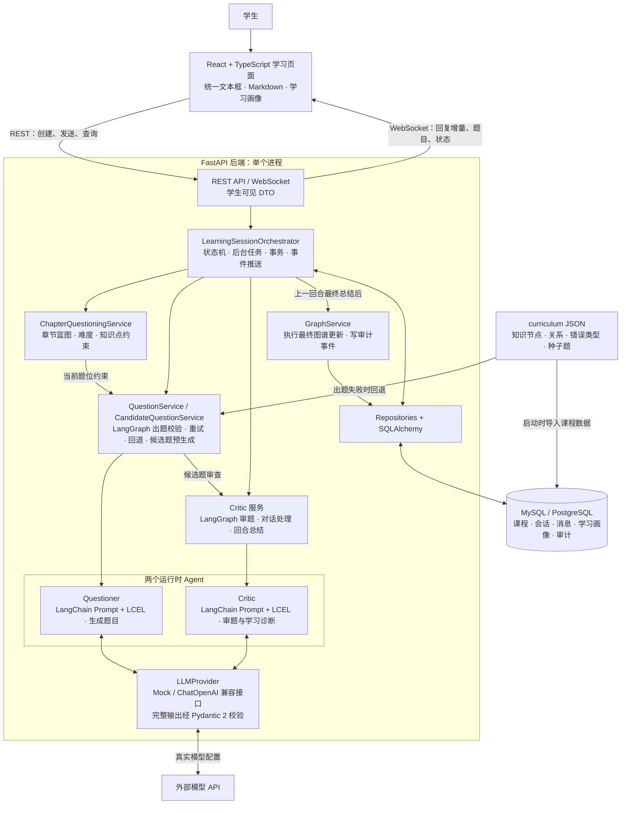
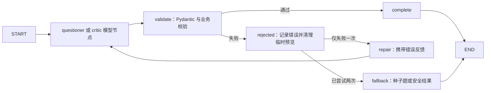
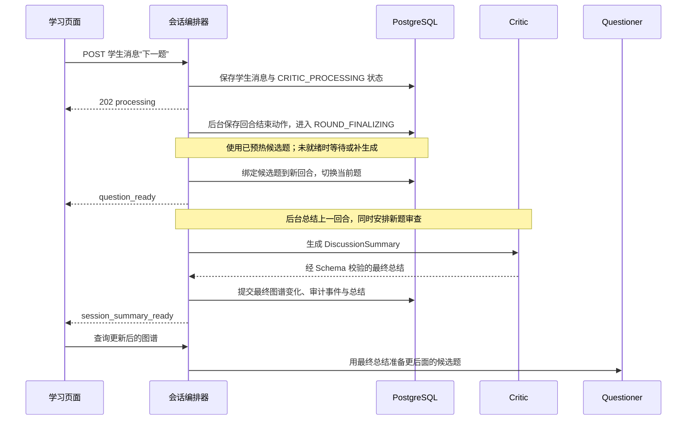

# PyCoach Lab 架构

本文描述当前源码实现。系统采用 **React 前端 + FastAPI 模块化单体 + LangChain / LangGraph 双 Agent + SQLAlchemy（MySQL / PostgreSQL）**，围绕“出题 → 作答 → 反馈讨论 → 回合总结 → 更新学习画像 → 后续出题”形成学习闭环。

运行时只有 Questioner 和 Critic 两个 Agent。题目生成与学习诊断由模型完成；会话编排、章节规划、数据更新和事件推送使用确定性代码。所有后端模块及后台任务都运行在 API 进程内。

## 整体架构图



图中服务是同一后端中的 Python 模块。部署时，Docker Compose 启动 `web`、`api`、`postgres` 三个服务；生产前端由 Nginx 提供静态资源，并把 `/api` 和 `/ws` 代理到 API。

## 模块职责与代码入口

| 模块 | 职责 | 入口 |
| --- | --- | --- |
| 学习页面 | 测试入口、导航、当前题目、对话和学习画像 | [LearningPage.tsx](../apps/web/src/pages/LearningPage.tsx) |
| 前端会话控制 | 会话状态、乐观消息、流式回复、切题和图谱刷新 | [useLearningSession.ts](../apps/web/src/hooks/useLearningSession.ts) |
| API 路由 | 创建与查询会话、接受学生消息、查询图谱、建立 WebSocket | [main.py](../services/api/app/main.py)、[api/](../services/api/app/api/) |
| 会话编排器 | 合法状态转换、Agent 调度、后台任务、持久化、故障恢复和事件推送 | [session_orchestrator.py](../services/api/app/services/session_orchestrator.py) |
| 章节规划器 | 根据模块、个人掌握度和活跃错误生成蓝图，提供当前题位的出题约束 | [chapter_questioning_service.py](../services/api/app/services/chapter_questioning_service.py) |
| 出题服务 | 组装上下文、调用 Questioner、检查题型与知识点、去重、重试和种子题回退 | [question_service.py](../services/api/app/services/question_service.py) |
| 候选题服务 | 预生成下一题、调用 Critic 审题、保存候选状态、失败时回退可信种子题 | [candidate_question_service.py](../services/api/app/services/candidate_question_service.py) |
| Critic 服务 | 用同一个 Critic 完成审题、答案评价、提示答疑、质疑改判和回合总结 | [critic_service.py](../services/api/app/services/critic_service.py) |
| Agent 工作流 | LangGraph 模型节点、业务校验、错误反馈、最多两次尝试和失败回退 | [workflow.py](../services/api/app/agents/workflow.py) |
| Agent 调用链 | LangChain ChatPromptTemplate、LCEL、Provider 调用和 Pydantic 边界复验 | [structured_chain.py](../services/api/app/agents/structured_chain.py) |
| 模型接口 | 统一结构化调用与学生可见字段流式接口，切换 Mock 或兼容模型服务 | [llm/base.py](../services/api/app/llm/base.py)、[dependencies.py](../services/api/app/core/dependencies.py) |
| 图谱服务 | 将最终证据转换成固定数值变化，生成学生摘要和审计记录 | [graph_service.py](../services/api/app/services/graph_service.py) |
| 数据访问 | 查询和保存课程、个人状态及学习过程 | [repositories/](../services/api/app/repositories/)、[entities.py](../services/api/app/models/entities.py) |

`LearningSessionOrchestrator` 和 `ChapterQuestioningService` 都是确定性业务模块，不增加运行时 Agent。编排器执行结构化结果中的动作；章节规划器通过固定规则选择题型、难度和目标知识点。

## 前端与通信契约

前端使用 React、TypeScript 和 Vite，`App` 直接挂载 `LearningPage`。页面视图通过本地 state 切换，会话逻辑集中在 Hook 中。当前没有独立管理员前端、路由库或全局状态库，API 客户端使用固定学习者 `demo_user`。

学习回合内，学生通过唯一文本框答题、追问和请求下一题：Enter 发送，Shift+Enter 换行，中文输入法选字期间的 Enter 只确认候选字。消息使用 Markdown 和代码高亮显示；进入下一题后，只展示当前题及本题对话，历史消息仍保存在数据库。知识与错误图谱在页面上展示为名称和状态列表。

### REST

| 接口 | 用途 |
| --- | --- |
| `GET /api/sessions/modules` | 查询后端支持的模块 |
| `POST /api/sessions` | 创建会话，等待首题生成并返回学生可见会话数据 |
| `GET /api/sessions/{session_id}` | 查询已持久化的消息、当前题目、状态和图谱摘要 |
| `POST /api/sessions/{session_id}/messages` | 保存学生消息，返回 `202 processing`，后台处理回复或换题 |
| `GET /api/learners/{learner_id}/knowledge-graph` | 查询学生可见知识状态 |
| `GET /api/learners/{learner_id}/error-graph` | 查询学生可见错误状态 |

前端发送消息时携带 `client_message_id`，用于关联乐观消息和服务端记录。后端有已有消息 ID 检查，但会先检查会话是否可接收消息；处理中重复发送仍可能收到 `409`，不能据此假设具备完整的幂等重放保证。

### WebSocket

`/ws/sessions/{session_id}` 用于主动推送学生可见事件：

| 事件 | 前端处理 |
| --- | --- |
| `connection_ready` | 更新学习服务就绪提示 |
| `message_stream_started` / `message_stream_delta` | 建立临时 Critic 消息并追加可见文本 |
| `message_stream_reset` | 清除本次未完成回复的文本，等待重试 |
| `critic_reply_ready` | 用最终消息替换临时流式消息，并更新会话状态 |
| `candidate_question_ready` / `candidate_question_stale` | 更新候选题准备状态 |
| `question_invalid` | 提示当前题目有问题 |
| `question_ready` | 显示新题，切换当前回合的消息视图 |
| `session_summary_ready` | 更新完成题数，并查询会话以刷新画像与题集进度 |

浏览器通过应用后端访问模型能力。WebSocket 事件使用专门的学生 DTO，只包含可见文本、必要状态和计数，不发送参考答案、评分规则、模型推理或图谱更新建议。

### 刷新与状态同步

后端的会话查询 API 可以读取已保存会话。当前前端初始化会主动清除旧会话标识、清空会话视图并加载个人图谱，回到测试选择流程；刷新页面不会自动继续旧会话，数据库中的历史记录与个人进度仍然保留。

WebSocket Hook 当前没有自动重连与退避机制，连接建立只更新就绪提示。处于 `CRITIC_PROCESSING` 或 `ROUND_FINALIZING` 时，前端会延迟查询会话作为兜底；收到最终总结事件时也会查询最新进度。这些机制不等于持续轮询或断线自动恢复。

## 双 Agent 与结构化输出边界

### LangChain 调用链与 LangGraph 工作流

Questioner 和 Critic 的提示词与上下文通过 `ChatPromptTemplate` 装载，随后由 LCEL `RunnableSequence` 调用 `LLMProvider` 并重新校验 Pydantic 输出。系统提示词、JSON Schema、上下文 JSON 和修复反馈都作为变量或消息传入，避免 JSON 花括号被当作模板表达式。

`StructuredAgentWorkflow` 使用真正编译的 LangGraph `StateGraph`，通过 `ainvoke` 执行 Questioner 出题以及 Critic 的审题、对话和总结任务：



每个任务只调用 Questioner 或 Critic 中的一个角色；其余节点执行确定性代码，不创建额外 Agent。验证失败将错误反馈给同一角色，最多调用模型两次。取消和未声明为可恢复的异常继续向上传播。工作流状态仅保存本次调用的次数、候选结果、校验反馈和最终结果；数据库 Session、流式回调都留在本次调用的闭包中，不写入图状态。当前不启用 checkpointer，业务会话、历史和最终诊断仍由现有关系表保存。

这次重构复用了项目已有的 Context Engineering（图谱、题位约束与回合上下文）、Pydantic Structured Output、FastAPI / Asyncio、SSE / WebSocket、SQLAlchemy / MySQL 和 Docker 能力。Agent 图管理一次模型任务的校验与修复；`LearningSessionOrchestrator` 继续管理学生回合和事务，二者职责分开。SQLAlchemy 仍为同步 Session，LangGraph 并未将数据库访问自动改为异步。

框架接口参考：[LangGraph Graph API](https://docs.langchain.com/oss/python/langgraph/graph-api)、[LangChain ChatOpenAI](https://docs.langchain.com/oss/python/integrations/chat/openai)。

### Questioner

Questioner 接收全局知识图谱、个人知识状态、错误状态、近期题目与尝试、章节题位约束、教学策略和 Critic 总结，输出 [QuestionPacket](../services/api/app/schemas/question.py)。

- `student_content` 保存学生题面与输入提示。
- `critic_content` 保存内部学习目标、参考答案、可接受答案、评分规则和预期推理。
- `QuestionService` 在 Schema 校验后继续检查题型、知识点、错误类型、代码行数和重复题。
- 输出失败会携带具体错误重试一次，连续失败后从课程种子题选择合法回退题。

Questioner 接收 Critic 的结构化总结来调整后续题目，学生原始讨论由 Critic 处理。

### Critic

同一个 Critic 承担三个结构化任务，契约见 [critic.py](../services/api/app/schemas/critic.py)：

| 任务 | 输出 | 使用方式 |
| --- | --- | --- |
| 审题 | `QuestionReview` | 标记 approved、needs_revision 或 invalid，供后端执行固定处理 |
| 处理学生消息 | `CriticTurnResult` | 提供学生回复、意图、判断、回合动作和 provisional 图谱建议 |
| 最终总结 | `DiscussionSummary` | 汇总最终判断、确认的证据、final 图谱建议和后续出题指导 |

Critic 结合当前题完整包、审题结果、当前回合对话、上一条 Critic 结果与候选状态处理答题、提示请求、追问和质疑。MVP 由 Critic 直接理解代码答案，不执行学生代码。

输出 Schema 和服务层还检查状态动作及安全规则，例如不把“我不确定”转换成具体负面知识证据。对话输出连续失败时，返回不更新图谱的安全回复；总结失败时使用不含图谱更新的安全总结。

### 模型调用、校验与流式预览

默认 `LLM_PROVIDER=mock`，使用 `DemoMockLLMProvider`。配置 `openai_compatible` 时，Provider 使用 `langchain-openai.ChatOpenAI` 调用兼容的 `/chat/completions`，连接参数继续从 `LLM_*` 环境配置读取。完整调用使用 `with_structured_output(..., method="json_mode", include_raw=True)`；流式调用复用 ChatOpenAI 配置的异步 SDK 客户端，并由适配器直接持有 SSE 响应的 `async with`，保证学生可见回调失败或任务取消时立即关闭 HTTP 流。当前 LangChain `astream` 的多层生成器包装不能保证早退时同步关闭全部子流，因此这里显式管理传输生命周期。模型 SDK 内部重试设为 0，避免与 LangGraph 的两次尝试叠加；关闭流式 usage 扩展并固定使用 Chat Completions 接口。

Agent Prompt 中附带 Pydantic 生成的 JSON Schema；完整响应先严格解析完整 JSON，再由 Pydantic 2 校验，不能将 LangChain 解析器修补出的截断 JSON 当作最终结果。`StrictModel` 禁止额外字段，枚举、范围和跨字段规则由各契约定义。完整结构化结果校验通过后，才能持久化模型结果并驱动状态变化。

Questioner 的题目在完整生成并校验后一次性展示。Critic 对话使用流式接口时，Provider 仅抽取 `student_visible_reply_markdown` 的增量文本发送给浏览器；这些片段属于完整 JSON 校验前的临时预览。完整结果校验失败会发送 reset 清除临时文本并重试，最终以 `critic_reply_ready` 确认消息。Mock 或未实现真实流式的 Provider 可以在生成完成后一次回调可见文本。

## 会话编排与换题时序

### 首题与学生消息

1. 创建 session 和 round，根据请求的 `module` 保存章节出题蓝图。
2. 取当前题位约束，构建 Questioner 上下文，生成并保存首题和 Questioner 消息，返回 `QUESTION_ACTIVE`。
3. 后台启动首题审查，并立即预热下一候选题。候选题预热已经提前到创建会话时开始。
4. 学生发送文本后，保存消息，状态经过 `USER_MESSAGE_RECEIVED` 进入 `CRITIC_PROCESSING`，REST 返回 202。
5. 后台处理 Critic 输出，保存回复和临时证据，按 `round_action` 回到答题、进入反馈讨论、替换题目或结束回合，并推送最终事件。

主要状态路径如下；完整合法转换及错误分支以 [ALLOWED_TRANSITIONS](../services/api/app/services/session_orchestrator.py) 为准：

```text
SESSION_CREATED → QUESTION_GENERATING → QUESTION_ACTIVE
QUESTION_ACTIVE / FEEDBACK_DISCUSSION
  → USER_MESSAGE_RECEIVED → CRITIC_PROCESSING
  → QUESTION_ACTIVE / FEEDBACK_DISCUSSION / ROUND_FINALIZING
ROUND_FINALIZING → NEXT_QUESTION_READY → QUESTION_ACTIVE
```

在反馈讨论阶段，精确匹配的“下一题”“继续”“next”等文本走固定快捷路径，生成不评分的 finalize 动作，随后仍由 Critic 在后台完成上一回合最终总结。其他自由输入交给 Critic 处理。

### 候选题与先展示下一题

候选题保存在 `questions` 表，使用 `candidate_provisional`、`candidate_ready`、`candidate_stale` 和 `candidate_failed` 状态。模型生成的候选题经过 Critic 审查后才供换题使用；审题失败或无效时可使用可信课程种子题回退。

当前换题顺序是：



因此，下一题可能已经可作答，而上一题图谱仍在后台结算；页面通过后续事件刷新画像。已预热候选题也可能早于上一题的最终诊断生成。当前实现会保留已有可用候选题，诊断变化通过最终总结指导后续候选题，而非每次质疑都立即废弃下一题。

等待候选题超时或换题失败时，编排器有恢复到反馈讨论的兜底路径，允许学生稍后重试或继续追问。

## 学习画像、持久化与审计

数据模型集中在 [entities.py](../services/api/app/models/entities.py)，当前有 14 张业务表：

| 分组 | 表 |
| --- | --- |
| 学习者 | `learners` |
| 全局课程图谱 | `knowledge_nodes`、`knowledge_edges`、`error_types` |
| 个人画像 | `learner_knowledge_nodes`、`learner_error_nodes` |
| 会话与计划 | `learning_sessions`、`learning_rounds`、`chapter_question_sets` |
| 题目与审题 | `questions`、`question_reviews` |
| 对话与诊断 | `conversation_messages`、`critic_turn_results` |
| 图谱审计 | `graph_update_events` |

图谱使用 PostgreSQL 关系表表达节点、边和个人状态。题目内容、内部评分资料、结构化诊断、最终总结及出题蓝图使用 JSON 列保存。一个 session 包含多个 round；当前正式题关联到当前 round，候选题发布时重新绑定到新 round。

过程诊断与最终学习记录分开：

1. Critic 对话结果中的 provisional 建议保存在 `critic_turn_results.result_json`，不直接修改个人画像。
2. 回合结束后，Critic 生成最终总结；题目无效时禁止提交图谱变化。
3. GraphService 按固定规则计算掌握度和错误严重度，范围限定在 `[0, 1]`。后端执行证据更新，不重新判断答案。
4. 一组最终图谱更新在嵌套事务中执行，失败时整组回滚。有效更新同时写入 `before_value`、`after_value`、`reason`、`round_id` 等审计字段。
5. 图谱查询将内部数值转换成学生可见的中文状态，只返回节点摘要。

换题发布和上一回合总结是两个阶段，因此 `finalized_at` 或完成题数不能单独作为“图谱更新已经提交”的信号；画像刷新应结合 `session_summary_ready` 与最新查询结果。

## 课程与章节规划

当前后端注册以下模块，可通过 `GET /api/sessions/modules` 查询：

| 模块 | 规划方式 |
| --- | --- |
| `python_iterator` | 迭代器 10 题蓝图，仍是服务层默认模块，API 可直接创建 |
| `python_foundation_diagnostic` | Python 教程第 3–9 章综合诊断，35 题 |
| `python_tutorial_ch3` 至 `python_tutorial_ch9` | 每章 10 题蓝图 |
| `python_challenge_ch3` 至 `python_challenge_ch9` | 每题动态选择未掌握知识点；计划目标题数字段为 50，按掌握度判断完成 |

前端当前提供综合诊断、章节测试和单题闯关入口，模块列表由页面常量定义。章节规划器读取个人掌握度与活跃错误，按固定规则推断学习水平，生成题型、难度、认知目标和目标知识点，再将当前题位转换成 `CandidateConstraints` 交给 Questioner。

课程数据位于 [python_iterator_v1](../curriculum/python_iterator_v1/) 和 [python_foundation_v1](../curriculum/python_foundation_v1/)。默认种子入口即使以迭代器目录启动，也会导入相邻的基础课程目录。全局课程数据幂等导入，已有个人学习进度保留；种子题由 QuestionService 读取用于失败回退，不在初始化时批量写入 `questions` 表。

仓库中的 Skill 提供出题方法与格式参考；运行时章节规划器使用代码中的规则，不会动态执行 Skill 或增加 Agent。

## 部署、测试与当前边界

- 开发环境：Vite 将 `/api` 和 `/ws` 代理到本地 FastAPI。生产镜像：Nginx 提供前端资源并同源反代到 `api:8000`。
- Compose 启动顺序：PostgreSQL 健康检查通过后启动 API；API 执行 Alembic 迁移和幂等种子导入，再启动 Uvicorn；API 健康后启动 web。
- 当前迁移包含 `0001` 和新增章节题集表的 `0002`，不应把早期验收记录中的表数量或迁移版本当作当前结果。
- 后台任务通过 `asyncio.create_task` 执行，任务集合、候选生成防重集合和 WebSocket 连接都保存在进程内。当前面向单进程 MVP；进程重启后，未完成后台任务不会续跑，已持久化记录仍可查询。
- 自动化测试使用 Mock Provider 或本地测试替身，覆盖 Schema、图谱、两个 Agent 的服务逻辑、状态机、REST/WebSocket 和前端交互；具体命令见 [TESTING.md](TESTING.md)。
- 当前使用 `demo_user`，没有登录、注册或多用户权限；没有代码执行沙箱、独立任务队列或图数据库。

当前代码的课程功能已超出 [AGENTS.md](../AGENTS.md) 声明的“仅迭代器”MVP 范围。本文记录现有实现，不修改该约束；后续功能与规范的范围需要保持一致。刷新不自动续接旧会话、Critic 流式预览、创建会话时即预热候选题，以及先发布下一题再结算上一题，均按当前源码行为描述。
